# Impossible Travel → Mailbox Forwarding Rule → Fraudulent Bank-Account Email (Compromised M365 Account)

**Published:** 2026-11-02

## 🎬 Scenario:

A Microsoft 365 identity alert flags **impossible travel** and **unfamiliar sign-in activity** for a company located in Vancouver, BC, Canada. The data provided (Splunk index `cloud`, 11 February 2024) contains Microsoft Entra ID interactive and non-interactive sign-ins and the Microsoft 365 unified audit log.

The exercise comes from the *Impossible Travel & Unfamiliar Sign-In* lab (MyDFIR Forge, SOC Analyst track, Month 2). It asks six questions:

1. Which account was compromised?
2. According to OSINT, where did the user log in from?
3. At what date and time (UTC) did this login occur?
4. Which activities were performed from that IP?
5. Did any other account log in from that IP?
6. If this alert were received, what would the next steps be?

The lab data was generated with third-party VPN providers; the lab instructs to ignore the VPN and focus on the location.

## 🧩 Contexte

As a SOC analyst, the task is to identify impossible travel and unfamiliar sign-ins in Splunk using transformation queries (`stats`, `eval`, `table`), answer the six questions, and document the findings.

- **SIEM:** Splunk
- **Index:** `cloud`
- **Timezone:** UTC
- **Incident Date:** 11 February 2024
- **Data Hour Range:** 01:29:00 => 22:47:48
- **Data Sources:**

| Files | Events | Start | End |
| --- | --- | --- | --- |
| `InteractiveSignIns_2024-01-12_2024-02-11.json` | 17 | 20:33:32 | 20:55:04 |
| `NonInteractiveSignIns_2024-01-12_2024-02-11.json` | 126 | 20:33:38 | 21:02:06 |
| `auditlogs.json` | 99 | 01:29:00 | 22:47:48 |

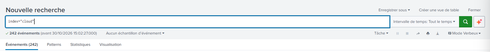

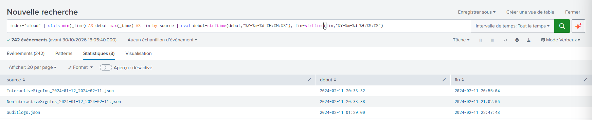

**Premises and limits stated up front**

- **Premises (from the lab):**
  - The company is located in Vancouver, BC, Canada.
  - Third-party VPN usage is ignored: the hypothesis "legitimate user behind a VPN" is excluded by the lab design, not by an observation. The hosting provider of the suspicious IP (M247) is context, not proof of intent.
- **Limits:**
  - A single day of logs (the file names announce 2024-01-12 → 2024-02-11, but all events fall on 2024-02-11): no history exists to build a "usual profile" per account.
  - Three sources only: no Entra ID audit logs (MFA method registration, application consents, role changes), no Exchange message trace, no network or endpoint logs.

## 📋 Investigation Summary

On 11 February 2024 (UTC), the account `jchan@7pd6vr.onmicrosoft.com` authenticated successfully from `181.214.153.165` (Vancouver according to OSINT) at 20:33:37, then from `188.214.125.138` (Singapore, M247 hosting, AS9009) at 20:46:42, a gap of **13 min 5 s** over roughly 12,800 km (about 59,000 km/h needed): an impossible travel. The log geolocation placed `181.214.153.165` and `181.214.153.176` in California; AbuseIPDB places both in Vancouver, so the reference location used in this report is Vancouver (lab premise + OSINT), not California.

The sign-in logs alone raise the detection signal; they do not prove a compromise. The first request from Singapore (20:46:37) shows a **valid password** (`authenticationDetails{}`) and then error code `50072` (MFA registration required), with no failed authentication from this IP in the available data. The account was prompted to enroll in MFA (`50072`), which indicates no MFA was registered (inference), and no MFA step succeeded from Singapore.

The audit log provides the discriminating evidence. About two minutes after the first Singapore success, from `188.214.125.138`, the mailbox of `jchan` was **modified twice**:

1. **An inbox rule** `1` (`New-InboxRule`, 20:48:37): it forwards the messages from `schan@7pd6vr.onmicrosoft.com` to `stoicellis@imcourageous.com`, moves them to Deleted Items and marks them as read.
2. **A mailbox-level SMTP forward** (`Set-Mailbox`, 20:48:54): `ForwardingSmtpAddress` set to `smtp:stoicellis@imcourageous.com` with `DeliverToMailboxAndForward` set to `False` (no local copy).

In the reference session from Vancouver, `jchan` only read mail and replied to a thread (`Re: First Invoice of the month!`, sent 20:33:58): no rule, no forwarding, no deletion.

From Singapore, the actor then created a reply draft with the same subject (20:49:09, never sent, later moved to Deleted Items), created a new message `URGENT: Client Bank Account` (20:56:59) and sent it at 20:58:54 with the attachment `NEW-BANK-ACCOUNT.pdf (43059b)`. The message reached the `\Finance` folder of `schan` eight seconds later. `schan` replied at 21:03:08 with `Signed-BANK-ACCOUNT.pdf (43071b)`, while the forwarding rule and the SMTP forward were active: a data leak is **probable**, not confirmed (no Exchange message trace in the lab).

How the password was obtained is **not established**: phishing, password reuse, infostealer and password spraying are all compatible with the data and none was tested.

## ⭕ Scoping

Scoping answers one question: how far did the activity reach? Each step below states its **objective**, then the query, and ends with a **result**, placed after the query and screenshot:

| Result | Meaning |
|---|---|
| ✅ **Observed negative** | The source that could show the activity was queried and nothing was found. The conclusion holds for that source and that time window only. |
| 🚫 **Not observable** | The available sources cannot show it, whatever the query: another source (named in the scoping item) is needed. No conclusion can be drawn. |
| ❔ **Not examined** | A source or track that could answer was available or reachable but was not queried in this hunt. It stays open. |

### 1. Other accounts from the suspicious IP

**Objective:** check whether the actor used other accounts than `jchan` (spread across identities).

Only `jchan` appears with `188.214.125.138`: 62 events in the two sign-in files (8 interactive, 54 non-interactive) and 34 in the audit.

`index="cloud" ipAddress="188.214.125.138" | stats count by source, userPrincipalName`

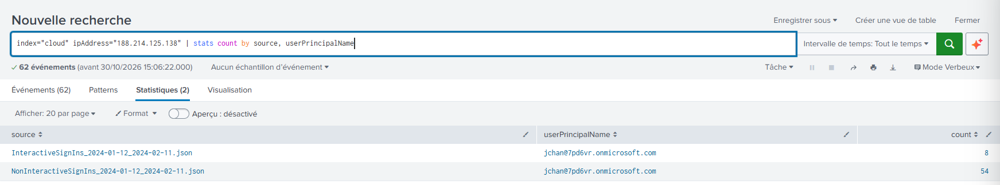

**Result:** ✅ Observed negative (only `jchan` appears with this IP, in the two sign-in files and in the audit; single day of logs)

### 2. Other IP addresses used by the actor

**Objective:** check whether the actor connected from a public IP address other than `188.214.125.138`.

The audit contains 16 distinct addresses: the three public IPv4 addresses already known (`181.214.153.165` and `181.214.153.176` are the legitimate references, `188.214.125.138` is the suspicious one) and 13 Microsoft IPv6 / `::1` addresses (service-side accesses). No other public IPv4 address appears.

`index="cloud" source="auditlogs.json" | eval ip=coalesce(ClientIPAddress, ClientIP, ActorIpAddress) | fillnull value="(none)" ip | stats count by UserId, ip`

(`coalesce` merges the three IP fields into one; `fillnull` keeps the events that carry no IP, so the counts add up to the 99 events.)

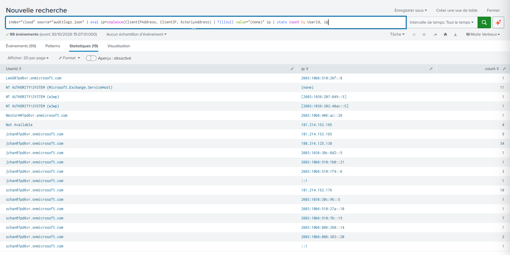

**Result:** ✅ Observed negative (no other public IPv4 in the audit file; the 13 other addresses are Microsoft service-side or `::1`)

### 3. One mailbox session or several

**Objective:** determine whether the actor used a single mailbox session or several, i.e. how many distinct sessions of the mailbox were opened from the suspicious IP.

Exchange events carry a `SessionId`. Among the 34 audit events that carry `188.214.125.138`, 22 share one `SessionId` (`6b0f5b6e-66e8-46ca-bc41-e6709104fb14`), all `jchan`; no second session appears. The other 12 carry no `SessionId` (11 Azure AD `UserLoggedIn` and one `MailItemsAccessed`), so they cannot be assigned to this session or to another one.

`index="cloud" source="auditlogs.json" "188.214.125.138" | fillnull value="(no SessionId)" SessionId | stats count by SessionId`

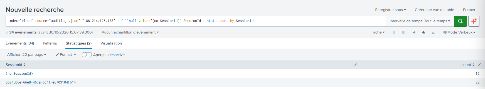

**Result:** ✅ Observed negative (one `SessionId` on 22 events, no second session identified; the 12 events without `SessionId` cannot be assigned)

### 4. Third-party applications

**Objective:** check whether the actor used non-Microsoft applications (persistence or access through an application).

Applications and resources seen from `188.214.125.138` are Microsoft services only. A first-party Microsoft client is not benign by nature, so token abuse is not ruled out; only persistence through a third-party application observable in these logs is.

`index="cloud" ipAddress="188.214.125.138" | stats count by source, appDisplayName, resourceDisplayName`

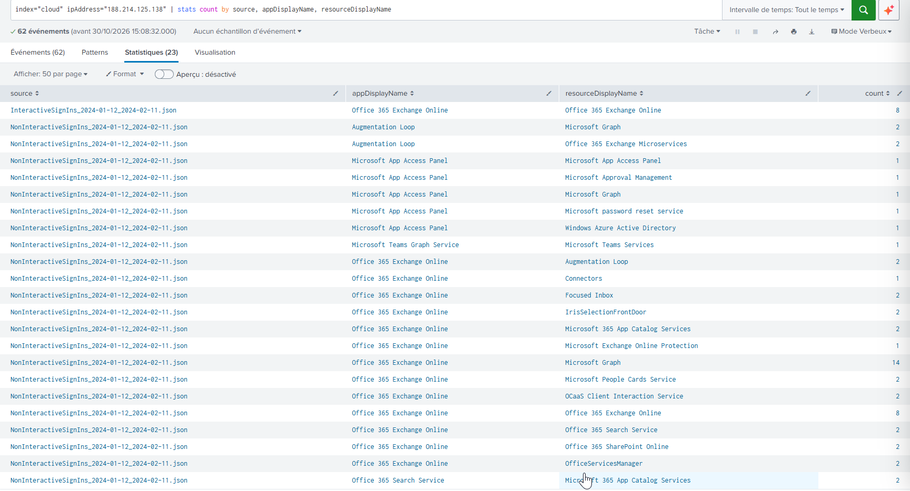

**Result:** ✅ Observed negative (limited: no non-Microsoft application seen; token abuse through Microsoft clients is not ruled out)

### 5. MFA use from Singapore

**Objective:** check whether the actor completed an MFA step (an MFA method in use would change the persistence and containment picture).

The MFA step is not completed (`succeeded` `false`) on the 4 `50072` lines from `188.214.125.138` (8 `50072` lines in the whole data set, including `schan` and the Vancouver session): no MFA use is observed.

`index="cloud" source="InteractiveSignIns_2024-01-12_2024-02-11.json" | sort 0 createdDateTime | table createdDateTime, userPrincipalName, ipAddress, status.errorCode, "authenticationDetails{}.authenticationMethod", "authenticationDetails{}.authenticationStepRequirement", "authenticationDetails{}.succeeded"` (trimmed version of the full sign-in table query)

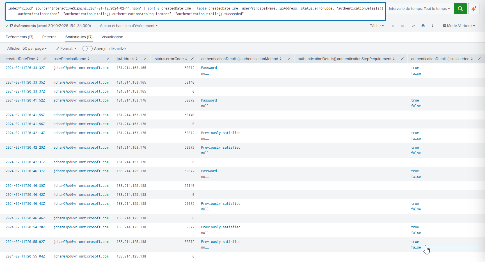

**Result:** ✅ Observed negative (MFA step not completed on the 4 `50072` lines from this IP; no MFA method used from this IP)

### 6. `schan`, the second account touched

**Objective:** check whether the colleague who received the fraudulent message was only exposed or also accessed by the actor.

Her sign-ins come only from `181.214.153.176` (macOS user agent). She received the fraudulent message and replied with an attachment. No access by the actor to her account is observed.

**Result:** ✅ Observed negative (no access to her account by the actor; exposure established, no compromise demonstrated at this stage)

### 7. Mailbox permissions, application consents, roles

**Objective:** check whether the actor created other persistence or privilege than the rule and the forward (delegated access, application consent, role change).

`auditlogs.json` contains 9 operation types (`MailItemsAccessed`, `UserLoggedIn`, `Set-Mailbox`, `MoveToDeletedItems`, `Create`, `Send`, `HardDelete`, `ModifyFolderPermissions`, `New-InboxRule`) over the Exchange and AzureActiveDirectory workloads: no permission delegation (`Add-MailboxPermission`, `Add-RecipientPermission`), application consent, role change or MFA registration.

`index="cloud" source="auditlogs.json" | stats count by Workload, Operation`

(`Workload` is the Microsoft 365 service that generated the event: `Exchange` for mailbox actions, `AzureActiveDirectory` for identity events such as sign-ins.)

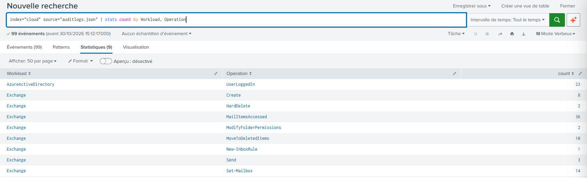

**Result:** ✅ Observed negative (audit file only; exhaustiveness of the export is not guaranteed)

### 8. `ModifyFolderPermissions`

**Objective:** qualify the only permission-related events found in the audit.

Two events (`schan` 20:12:16, `jchan` 20:33:40; address `::1`, no parameters). The `jchan` event shares the `SessionId` of the Vancouver reference session, and both predate Singapore: their exact effect is unknown.

**Result:** ✅ Observed negative (no link with the actor established)

### 9. What the available sources cannot answer

**Objective:** list what the data cannot say, to avoid concluding beyond the evidence.

- **MFA method registered by the actor:** needs the Entra ID audit logs (authentication-methods activity).
- **Messages actually forwarded outside:** needs the Exchange message trace.
- **Attachment opened by the actor or recipients:** attachment opens are not logged as such.
- **How the password was obtained:** no source in the lab shows it.
- **Lateral movement and access to other credentials:** no dedicated source.
- **Content of Deleted Items and of the soft-deleted drafts:** not available in the lab data.

**Result:** 🚫 Not observable (MFA registration, forwarded messages, attachment opens, password origin, lateral movement, other credentials, deleted content)

## 🚧 Criticality, Impact, and Response

**Confirmed impact (facts).**

- **Mailbox configuration modified twice by the actor, both from `188.214.125.138`:**
  1. **Inbox rule `1`** (`New-InboxRule`, 20:48:37)
     - **What it does:**
       - forwards messages to `stoicellis@imcourageous.com` (`ForwardTo`);
       - only for messages from `schan@7pd6vr.onmicrosoft.com` (`From`);
       - moves them to Deleted Items (`MoveToFolder`);
       - marks them as read (`MarkAsRead` `True`);
       - stops the processing of further rules (`StopProcessingRules` `True`).
     - **Scope:** only messages from `schan`; a copy remains in Deleted Items.
  2. **Mailbox-level SMTP forward** (`Set-Mailbox`, 20:48:54)
     - **What it does:**
       - forwards incoming mail to `smtp:stoicellis@imcourageous.com` (`ForwardingSmtpAddress`);
       - keeps no copy in the mailbox (`DeliverToMailboxAndForward` `False`).
     - **Scope:** all incoming mail of `jchan`; no local copy.

  **Combined effect (inference):** the actor receives the replies of `schan` while `jchan` does not see them.
- **Mailbox access:** `\Inbox` and `\Sent Items` accessed from `188.214.125.138` at 20:46:50 and 20:46:59; what was read is not observable.
- **Fraudulent message delivered:** `URGENT: Client Bank Account` with `NEW-BANK-ACCOUNT.pdf (43059b)` reached `\Finance` of `schan` at 20:59:02 and was accessed again at 21:01:13, 21:01:14, 21:01:28, 22:12:56 and 22:43:58.
- **`schan` replied** with `Signed-BANK-ACCOUNT.pdf (43071b)` at 21:03:08 from her own IP.

**Data leak**

- **Level:** probable, not confirmed.
- **Why probable (facts):** the inbox rule (20:48:37) and the SMTP forward (20:48:54) were active when `schan` replied with `Signed-BANK-ACCOUNT.pdf` (21:03:08).
- **Why not confirmed (two inferences stack):**
  1. The reply was addressed to `jchan`: the `Send` event carries no recipient field; only the `Re:` prefix and the rule's sender filter suggest it.
  2. The forward processed that message: the audit shows no delivery trace, and the message identifier appears in no `jchan` event.
- **What would confirm it:** the Exchange message trace (messages forwarded to `stoicellis@imcourageous.com`), not available in the lab.
- **Exposure window:** from 20:48:37 / 20:48:54 until the rule and the forward are removed (removal not observed in the logs).

**Response** (priority order, each step tied to a fact above):

1. **Escalate to incident response and form a crisis cell including finance**, because a potentially confidential signed document was shared with an external recipient. Attach a report with: the impossible-travel evidence and IOCs; the persistence evidence (inbox rule + SMTP forward); the impersonation evidence (fraudulent message sent from the compromised account to `schan`); the reception and reply by `schan`.
2. **Preserve evidence first, before any change:** unified audit log, sign-in logs, Exchange message trace, and the soft-deleted drafts (moved to Deleted Items, recoverable — not `HardDelete`).
3. **Identity (in parallel):** revoke sessions and tokens and reset the password of `jchan`; remove inbox rule `1` and `ForwardingSmtpAddress` in the same operation so the persistence is not left behind; have the legitimate user register MFA. Before closing, review the Entra ID audit logs for MFA methods registered and application consents since 20:46 (not observable in the lab data).
4. **Fraud:** analyze Exchange messages (message trace: recipients, forwarded messages), recall or purge the message, alert finance, block `imcourageous.com` (domain taken from the rule).
5. **`schan`:** interview her (content of her reply, whether she opened or forwarded the message, any other message from `jchan`, an unknown address or `stoicellis@imcourageous.com`) and check her sign-ins and MFA prompts. Scope statement: *exposure, with no compromise demonstrated at this stage*.
6. **Data leak and compliance:** treat the signed document as presumed leaked until the message trace says otherwise; involve the DPO — any notification obligation depends on the applicable jurisdiction.
7. **Post-incident:** establish the probable cause of the credential leak and the MFA gap (`50072`, MFA enrollment required, on both accounts).

## ⛓️ CyberKillChain : IOA/IOC

| IOA (Behavior) | Kill Chain Phase | MITRE Technique | IOC (Artifact) | SPL |
|---|---|---|---|---|
| Successful authentication with a valid password from a hosting IP, no prior failure observed; MFA registration prompt (`50072`) | Initial Access | **T1078.004 — Valid Accounts: Cloud Accounts** | `188.214.125.138` (AS9009, M247, Singapore); first request 20:46:37, first success 20:46:42 | `index="cloud" source="InteractiveSignIns_2024-01-12_2024-02-11.json" \| sort 0 createdDateTime \| table createdDateTime, userPrincipalName, ipAddress, status.errorCode, "authenticationDetails{}.authenticationMethod", "authenticationDetails{}.succeeded"` |
| Access to `\Inbox` and `\Sent Items` from the suspicious IP | Collection | **T1114.002 — Email Collection: Remote Email Collection** | `MailItemsAccessed` 20:46:50 and 20:46:59, `ClientIPAddress` `188.214.125.138` (probable: what was read is not observable) | `index="cloud" source="auditlogs.json" "188.214.125.138" \| sort 0 CreationTime \| table CreationTime, Operation, UserId, ClientIP, ClientIPAddress, ActorIpAddress, "Folders{}.Path"` |
| Inbox rule forwarding a colleague's messages to an external address, plus a mailbox-level SMTP forward without local copy | Collection / Persistence of mailbox access | **T1114.003 — Email Collection: Email Forwarding Rule** | Rule `1` (`ForwardTo`), `ForwardingSmtpAddress` `smtp:stoicellis@imcourageous.com`, `DeliverToMailboxAndForward` `False` | `index="cloud" source="auditlogs.json" "188.214.125.138" Operation IN ("New-InboxRule","Set-Mailbox") \| table CreationTime, Operation, ClientIP, "Parameters{}.Name", "Parameters{}.Value"` |
| Same rule moves the colleague's messages to Deleted Items and marks them read (hiding intent is an inference) | Stealth | **T1564.008 — Hide Artifacts: Email Hiding Rules** | `MoveToFolder` Deleted Items, `MarkAsRead` `True`, `StopProcessingRules` `True`, `From` `schan@7pd6vr.onmicrosoft.com` | same as the row above |
| Fraudulent message sent from the compromised account to the finance colleague, with a bank-account attachment | Actions on objective | Not mapped (`T1534` considered: ATT&CK lists it under Lateral Movement, and no lateral movement is demonstrated; `T1657` not applicable: no loss observed) | `URGENT: Client Bank Account`, `NEW-BANK-ACCOUNT.pdf (43059b)`, `InternetMessageId` `<PH7PR19MB818854FAFD1785788A21353691492@PH7PR19MB8188.namprd19.prod.outlook.com>` | `index="cloud" source="auditlogs.json" "PH7PR19MB818854FAFD1785788A21353691492@PH7PR19MB8188.namprd19.prod.outlook.com" \| sort 0 CreationTime \| table CreationTime, Operation, UserId, MailboxOwnerUPN, ClientIPAddress, ClientInfoString, "Folders{}.Path"` |
| Reply from the colleague carrying an attachment while the forward is active | Actions on objective (exposure) | Not mapped (victim behavior) | `Signed-BANK-ACCOUNT.pdf (43071b)`, `InternetMessageId` `<PH0PR19MB52430398CEA6FAB1581F028D88492@PH0PR19MB5243.namprd19.prod.outlook.com>` | `index="cloud" source="auditlogs.json" "PH0PR19MB52430398CEA6FAB1581F028D88492@PH0PR19MB5243.namprd19.prod.outlook.com" \| sort 0 CreationTime \| table CreationTime, Operation, UserId, MailboxOwnerUPN, ClientIPAddress, ClientInfoString, "Folders{}.Path"` |

**MITRE technique IDs** (verified on attack.mitre.org on 2026-10-30; ATT&CK v20, none revoked):

| Technique | Name | Tactic(s) | In the table above |
|---|---|---|---|
| `T1078.004` | Valid Accounts: Cloud Accounts | Stealth, Persistence, Privilege Escalation, Initial Access | Yes (Initial Access) |
| `T1114.002` | Email Collection: Remote Email Collection | Collection | Yes |
| `T1114.003` | Email Collection: Email Forwarding Rule | Collection | Yes |
| `T1564.008` | Hide Artifacts: Email Hiding Rules | Stealth | Yes |
| `T1534` | Internal Spearphishing | Lateral Movement | No: considered, but no lateral movement is demonstrated |
| `T1657` | Financial Theft | Impact | No: no loss observed |
| `T1070.008` | Indicator Removal: Clear Mailbox Data | Stealth | No: deletion of drafts, intent to erase evidence not established |

- **Not mapped:** acquisition of the password (the mechanism is unknown).
- **SPL column:** trimmed versions of the full queries (fewer columns, same filters).

**Other indicators**

| Type | Value |
|---|---|
| `SessionId` (Singapore mailbox session) | `6b0f5b6e-66e8-46ca-bc41-e6709104fb14` |
| Inbox rule name | `1` |

**Seen in the logs but not indicators** (they do not identify the attacker):

- **The `Identity` parameter of `Set-Mailbox`:** it is the identifier of the mailbox that was modified, that is the victim's mailbox (`jchan`), not something the attacker brought.
- **The IPs `181.214.153.165` and `181.214.153.176`:** they are the normal sessions of `jchan` and `schan` from Vancouver. Listing them as indicators would flag legitimate users.

## 🕒 Timeline

All times UTC, 11 February 2024.

- Reference session (Vancouver)
  - 20:12:16 : `ModifyFolderPermissions` for `schan` (`::1`, no parameters)
  - 20:33:32 => 20:33:37 : `jchan` from `181.214.153.165`: `50072`, `50140`, `0` (success at 20:33:37); non-interactive token burst until 20:33:57
  - 20:33:40 : `ModifyFolderPermissions` for `jchan` (`::1`), same `SessionId` as the reference session
  - 20:33:43 => 20:33:58 : `jchan` (OWA) reads mail, creates (20:33:48) then sends (20:33:58) `Re: First Invoice of the month!`
  - 20:41:52 => 20:42:31 : `schan` from `181.214.153.176` (6 interactive lines)
    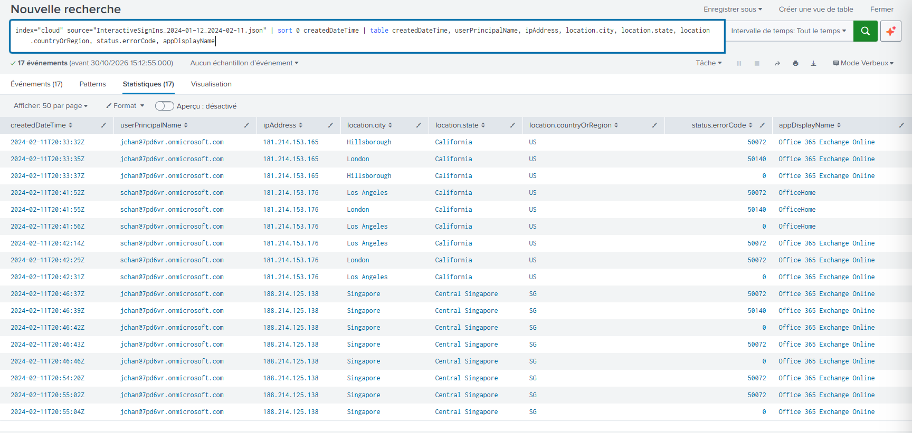
- Impossible travel and access
  - 20:46:37 : first request from Singapore: password correct, MFA required (`50072`)
  - 20:46:39 => 20:46:46 : `50140`, first success (`0`) at 20:46:42, then `50072` / `0`
  - 20:46:47 : first non-interactive token burst (15 lines: Exchange, Graph, Search, Teams Graph Service, etc.)
  - 20:46:50, 20:46:59 : `MailItemsAccessed` on `\Inbox` and `\Sent Items`
    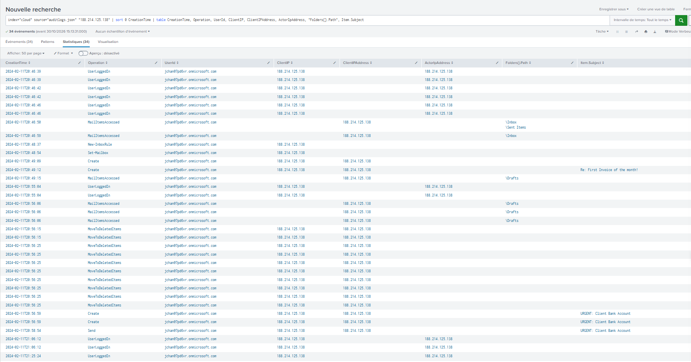
- Persistence and preparation
  - 20:48:37 : `New-InboxRule` `1` (forward to `stoicellis@imcourageous.com`, messages from `schan`, moved to Deleted Items, marked read)
  - 20:48:54 : `Set-Mailbox` with `ForwardingSmtpAddress`, `DeliverToMailboxAndForward` `False`
    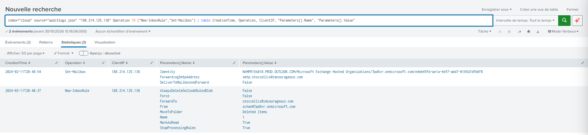
  - 20:49:09 => 20:49:15 : draft `Re: First Invoice of the month!` created, never sent
  - 20:54:20 => 20:54:30 : `50072`, then App Access Panel sequence (5 non-interactive lines); 20:55:04 success (`0`), second token burst (21 lines from 20:55:07)
- Cleanup and fraudulent message
  - 20:56:15 => 20:56:25 : 10 `MoveToDeletedItems` in `\Drafts` (soft deletion, including several versions of the `Re:` draft)
  - 20:56:59 : draft `URGENT: Client Bank Account` created
  - 20:58:54 : `Send` of `URGENT: Client Bank Account` with `NEW-BANK-ACCOUNT.pdf (43059b)` via OWA
    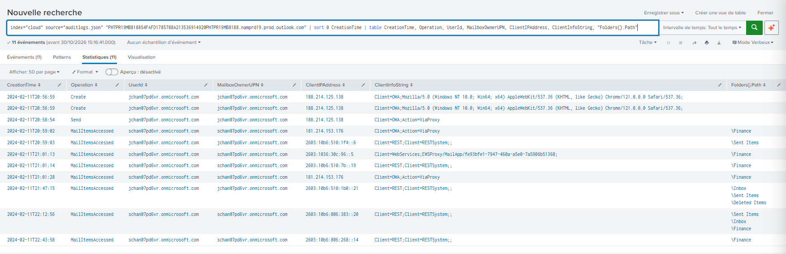
- Exposure of `schan`
  - 20:59:02 : message appears in `\Finance` of `schan` (OWA, `181.214.153.176`)
  - 21:01:08 => 21:01:36 : `schan` creates three reply drafts, `HardDelete` of drafts at 21:01:16 and 21:01:22, accesses the message at 21:01:13, 21:01:14, 21:01:28
  - 21:03:08 : `schan` sends `Re: URGENT: Client Bank Account` with `Signed-BANK-ACCOUNT.pdf (43071b)`
    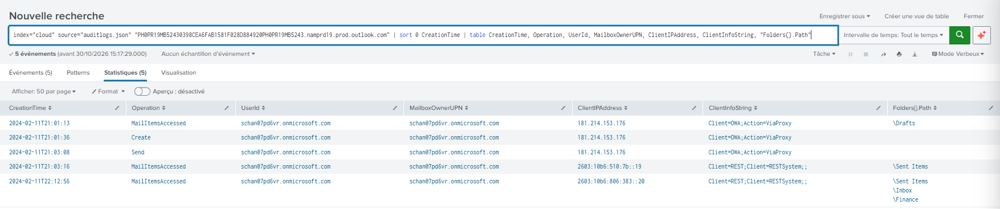
- After the message
  - 21:06:12, 21:25:24 : `UserLoggedIn` from `188.214.125.138` (no matching line in the sign-in files)
  - 21:47:15 : system access to `\Inbox`, `\Sent Items`, `\Deleted Items` of `jchan` from a Microsoft IP
  - 22:12:56, 22:43:58 : system accesses of `schan` to the fraudulent message
  - 22:47:48 : last event of the audit source

## 🔎 Reputation Analysis

### Infrastructure Reputation

#### AbuseIPDB: `188.214.125.138`

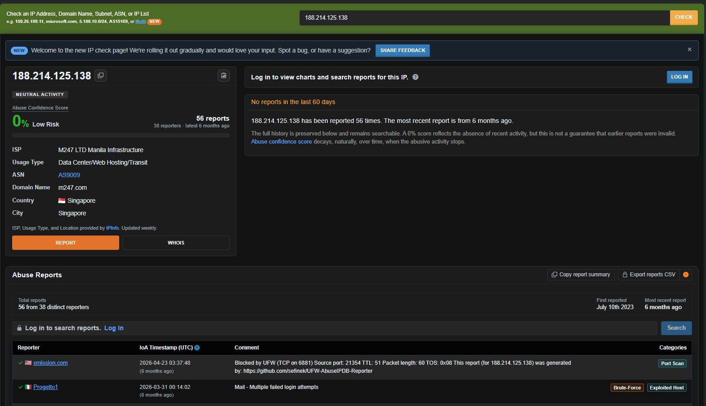

- Abuse Confidence Score 0 %, 56 reports from 38 distinct reporters (first reported 2023-07-10, most recent about six months before the lookup, no report in the last 60 days).
- Two reports are visible without an account: 2026-04-23 (category Port Scan) and 2026-03-31 (`Mail - Multiple failed login attempts`, categories Brute-Force and Exploited Host); the rest of the history requires an account.
- ISP `M247 LTD Manila Infrastructure`, usage "Data Center / Web Hosting / Transit", ASN `AS9009`, domain `m247.com`, Singapore. The ASN matches the one in the logs.
- The 0 % score despite the reports reflects score decay over time (AbuseIPDB states that the score decays when the abusive activity stops). A hosting provider does not imply malicious intent (see the lab premise on VPNs).

#### AbuseIPDB: `181.214.153.165` (`jchan`, reference)

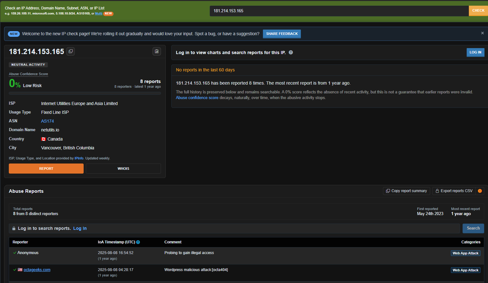

- Score 0 %, 8 reports from 8 distinct reporters (first reported 2023-05-24, most recent about one year before the lookup, no report in the last 60 days), ISP `Internet Utilities Europe and Asia Limited`, usage "Fixed Line ISP", ASN `AS174`, domain `netutils.io`, Canada, Vancouver, British Columbia (IPinfo).
- Two reports are visible without an account, both dated 2025-08-08 (category Web App Attack, comments about probing and a WordPress attack). They postdate the incident by about 18 months and do not describe the activity of 2024-02-11.

#### AbuseIPDB: `181.214.153.176` (`schan`)

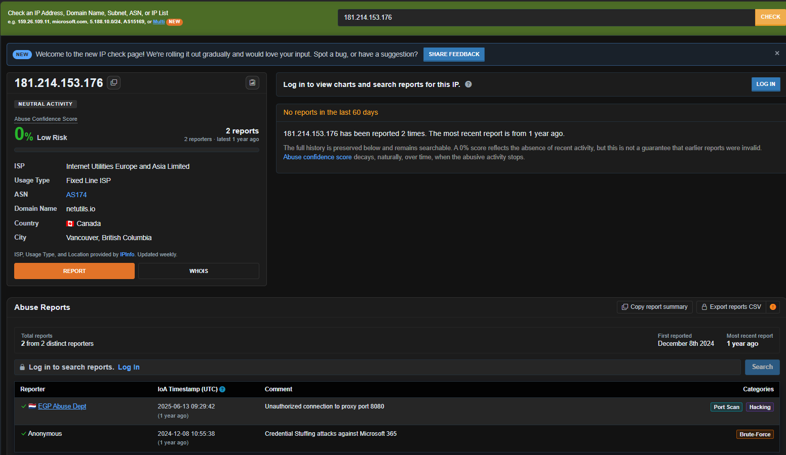

- Score 0 %, 2 reports from 2 distinct reporters (first reported 2024-12-08, most recent about one year before the lookup, no report in the last 60 days), same ISP, usage type, ASN and domain as `181.214.153.165`, Canada, Vancouver, British Columbia.
- Two reports are visible, both after the incident: 2024-12-08 (Brute-Force, `Credential Stuffing attacks against Microsoft 365`) and 2025-06-13 (Port Scan and Hacking, `Unauthorized connection to proxy port 8080`). They do not describe the activity of 2024-02-11.

The log geolocation (California: Hillsborough, London, Los Angeles) disagrees with AbuseIPDB for both `181.214.153.x` addresses and agrees for Singapore. The origin of the gap is not established; AbuseIPDB (IPinfo, updated weekly) is a geolocation database, not ground truth. All three lookups were done on 2026-10-30, about 21 months after the incident: the reputation reflects the current state of each address, not its state on 2024-02-11.

### Uncertainties

- How the password was obtained was not established; phishing, reuse, infostealer and password spraying were not tested. Failures on other days are invisible (single-day logs).
- Whether the actor registered an MFA method or granted application consent cannot be answered with these sources (Entra ID audit logs needed).
- Whether messages were actually forwarded outside, and which ones, cannot be answered without the Exchange message trace; the leak is rated probable.
- The domain `imcourageous.com` and the address `stoicellis@imcourageous.com` were not looked up in OSINT.
- The `188.214.125.*` range was not checked for other accounts, and the values of the Entra risk fields were not read.
- The nature of the two `ModifyFolderPermissions` events (`::1`, no parameters) is not established.
- Five system accesses to the mailbox of `jchan` cannot be attributed to the Singapore session.
- The two reference IPs carry abuse reports dated after the incident (2024-12 and 2025). Their reputation therefore does not by itself prove they were clean on 2024-02-11: they are treated as references because of the lab premise (Vancouver) and the behavior of their sessions.

## 🏢 Organization-Side Improvements (to validate)

- Enforce MFA registration and use: both accounts showed `50072` (MFA enrollment required, so no MFA registered).
- Block or alert on automatic external forwarding and on `New-InboxRule` with an external `ForwardTo` or `Set-Mailbox` with `ForwardingSmtpAddress`.
- Keep the Exchange message trace and Entra ID audit logs available to confirm or rule out a leak and a registered MFA.
- Compare log geolocation with OSINT before alerting on impossible travel, and base the usual profile on more than one day.
- A generalized detection query (impossible travel, unfamiliar sign-in) is a possible improvement; the lab asks for transformation queries, already used here.

## 🪞 Reflection and Next Steps

### What I Learned, How It Felt, and the Marginal Gain

**What I learned**

- **A contextual approach to the alert:** put on the table what is within reach (sources, time bounds, volumes, fields, error codes) before querying.
- **Objective and hypotheses first:** define them before looking for proof or disproof, through queries or other analysis.
- **Skills gained:** handling an alert, understanding the data available, the questions to ask, the leads to follow and the approach to follow them.

**How it felt**

- Overall good: I feel I learned and gained skills.
- One reservation: the time and energy it took. That stays relative for a subject I did not really know, and these are still among my first times doing this kind of exercise.

**Marginal gain identified**

- I can now recognize an impossible travel, investigate to determine its impact, and initiate a response plan (at least propose one).
- I gained reflexes in the controls, but my method and its framework are not yet set: this is the work that remains (see the next points).

### Framing Before Querying (a habit to keep)

The week of 12 to 18 October went into definitions, a field inventory and a query plan before the first sign-in query. That framing made the impossible travel readable on 19 October, after a start where the logs felt overwhelming. The lab setup (hash checks, VM, Splunk timezone) reused the method of the AD 2.0 project, in 30-minute slots, and worked the same way.

**Next action:** keep the framing step as a fixed first step of every hunt (objective, hypotheses with the conditions to prove them, sources with time bounds, volumes, fields and error codes), and keep the journal and a log of the queries as the memory of the hunt.

### Build an Identity Map from the Gaps Met During This Hunt

The investigation grind map built at the end of this hunt describes how to handle an alert (framing, extraction, deduction, qualification). It does not describe the identity theory behind it. The points that slowed the investigation were exactly those gaps: MFA enrollment (`50072`), the `50140` prompt, the "claim in the token" lines, interactive versus non-interactive sign-ins, application consents and roles, each researched on the spot.

**Next action:** build a second grind map dedicated to identity, one branch per 30-minute slot, starting from these gaps (first branch: tokens and sessions), with each branch linked to an ATT&CK tactic so it can feed the global "Art of Investigation" map.

### Write the First Draft of the SPL Myself

My query log marks 5 of the 30 queries used as written by me. I chose the fields and what to query, and the syntax came from an AI assistant, so the reasoning was mine but the writing was not.

**Next action:** write the first draft of each query myself and ask for a review afterwards; keep a short list of reusable patterns taken from this hunt (`table` with `sort 0`, `stats count by`, `coalesce` with `fillnull`, a raw-term IP search, a pivot on an `InternetMessageId`).

### Define a Mechanism Before Writing Its Name

Four terms were wrong or imprecise in my notes: an inbox rule called a transport rule, an internal mail propagation called lateral movement, an account without registered MFA called an MFA bypass, and `MailItemsAccessed` read as "delivered but never opened" when it records access to mailbox items. Each one changed the conclusion that followed.

**Next action:** before writing a mechanism term in the notes, add a one-line definition taken from the official documentation to a glossary, and fill it as the investigation goes.

### Write the Evidence Level Before Concluding

Several conclusions came before the evidence:

- The sign-in logs alone raised the impossible travel; the compromise was established by the audit (inbox rule and SMTP forward created from the suspicious IP, compared with the Vancouver session that only read and replied to a thread).
- The reference IP `181.214.153.165` was used as the "normal" location without an OSINT lookup, while the log geolocation was already shown wrong for `181.214.153.176`.
- The leak was first called confirmed, then probable.
- The first IP inventory returned 88 events instead of 99, and a reply from `schan` was missed because page 2 of the results was not opened.

**Next action:** before writing "compromised", note the observation that separates the competing hypotheses (source, field, value) and rate each conclusion confirmed, probable or possible; run an OSINT lookup on every baseline IP and write its date; after every `stats`, add up the counts against the total number of events and open every page of results; end each scoping item with observed negative, not observable or not examined.

### Time-Box the Detours

On 20 October, researching MFA (authentication details, hypotheses on the "claim in the token" lines) took the investigation away from the six questions of the lab until I stepped back and returned to them.

**Next action:** spend at most 15 minutes on an unfamiliar topic, then write it down in a list of leads and go back to the lab question.

### Open Tracks Left as Limits

The Entra risk fields, OSINT on `imcourageous.com` / `stoicellis@imcourageous.com` and the `188.214.125.*` range were deliberately left as limits in this report.

**Next action:** read `riskLevelDuringSignIn`, `riskState`, `riskDetail` and `riskEventTypes_v2{}` on the 5 interactive events; look up the external domain and address (registration date, MX, reputation); search the `188.214.125.*` range for other accounts.

## 🧭 Investigation Framework: Identity

This hunt was worked with a personal investigation framework built from the lab (grind map "Investigation-Identity", V0.4): **Framing** (objectives → hypotheses → conditions to prove them; context: sources, time bounds, volumes, fields, error codes) then **Investigation** (extraction by query ↔ deduction on hypotheses, with verdicts confirmed / refuted / inconclusive; qualification: scope, impact, OSINT), with a question bank per theme (connection, privilege, persistence, scope, OSINT). It is a living framework and was refined while writing this report.

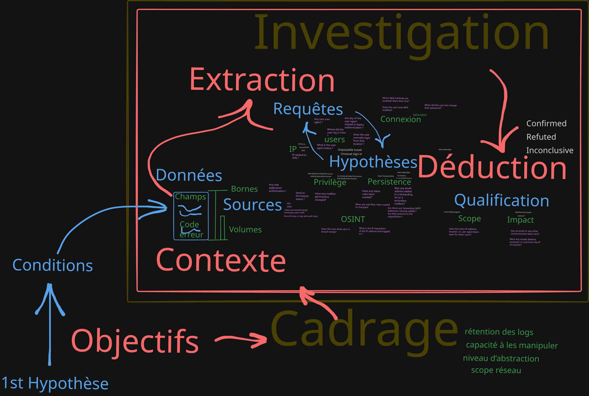
