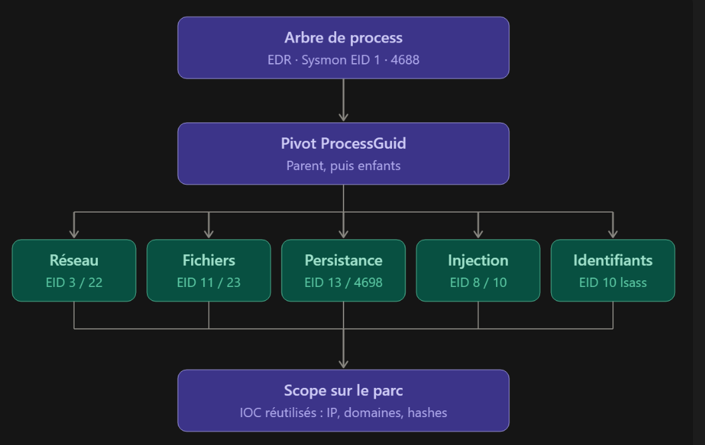

# Scenario of the Week 14 — Quarantined Double-Extension Attachment on an HR Workstation

**Published:** 2026-10-29

## 🎬 Scenario

```
Antivirus quarantined a file named "resume_update.docx.exe" on an HR workstation. The user says a job applicant
emailed it to them and they opened it to review the candidate's resume. The file was caught before execution.
```

## 🧭 Guided Questions

- What questions would you ask?
- What would you investigate and in what order?
- Who would you communicate with and when?
- What's your gut telling you and how would you confirm it?

## 📝 First Response

**What's your gut telling you and how would you confirm it?**
I start by scoping and organizing the information provided by the alert with the context / anomaly / priority
triptych:

- **Context** — an HR employee received an email with an attachment and opened it, which led the antivirus to
  quarantine the file.
- **Anomaly** — `resume_update.docx.exe` was quarantined by the antivirus after the user opened it, and the `.exe`
  following `docx` may indicate an extension spoofing attempt.
- **Priority** — the antivirus alert and the potential activity linked to opening this file on the machine, to
  confirm the impact of the opening.

I then set hypotheses on two main axes to segment the analysis:

1. **False positive** — the file is a legitimate executable, for example a self-extracting archive created in good
   faith by the candidate, or an interactive resume packaged as an executable.
2. **True positive** — a malicious file arrives by email as an attachment with a credible pretext (ATT&CK T1566.001
   – Phishing: Spearphishing Attachment), combined with a masked file extension (ATT&CK T1036.007 – Masquerading:
   Double File Extension), waiting for a user interaction (double click) to run a malicious file (ATT&CK T1204.002
   – User Execution: Malicious File).

To determine the alert's status efficiently, I define an order of verification of the logs according to their
discriminating power relative to their cost of retrieval (time, tooling, skills). The `.docx.exe` double extension
makes malicious intent very likely. The priority question is therefore whether the file ran when it was opened,
before it was blocked:

1. Analysis of the alert raised by the AV/EDR to determine the detection type (on-access or at launch), the
   timestamp relative to the declared opening, the success of the quarantine, and the hash. This resolves the
   contradiction between "opened" by the user and "blocked before execution".
2. Analysis of the process-creation telemetry linked to the file (parent `explorer.exe`), children, network
   activity, created files, or persistence on the endpoint. This verifies the impact and allows escalation if
   needed.
3. Scope analysis: other recipients, and the file's hash present on other machines. This determines whether the
   incident is isolated or part of a campaign.

I then calibrate the alert by setting 3 conditions associated with a graduated response:

- **Level 1** — the file is legitimate: I release it to the user and close the ticket.
- **Level 2** — the file is malicious and the block is confirmed from the AV/EDR alerts, corroborated by the
  endpoint telemetry. Before closing, I make sure the entire scope is handled, the IOCs are blocked, users are
  made aware through a reminder of the procedures, and I create a linked internal SOC ticket to start a reflection
  on the fact that an `.exe` reaches a mailbox.
- **Level 3** — if a process is started from the file, I escalate the alert to the incident manager to respond to
  the threat globally and coordinate a full isolation of the endpoint, a scope analysis and, depending on the
  results, eradication, recovery and post-incident activities.

Before starting the investigation, I set the volatility and impact axes to determine the capture approach and the
conditions that trigger it:

- **Volatility** — the alert comes from a workstation after a user opened a file, so I use the RFC 3227 guidelines
  for collection, depending on the detection type:
  1. **Detection at write** — the file reaches the disk but is never launched, so there is no volatile
     collection. I retrieve a sample of the file before it is purged and get its hash to search for its existence
     across the organization.
  2. **Detection at launch** — the file was launched (even for an instant):
     1. **Block confirmed** — everything planned for detection at write, plus a light volatile triage through the
        EDR live response (processes and tree, active connections, DNS cache) and the disk artifacts: Prefetch,
        Amcache, scheduled tasks, and recent Run keys.
     2. **Execution proven** — full memory dump; if impossible, full volatile triage (processes and tree with
        command lines, active connections, DNS cache, ARP cache, open sessions, running services and tasks) with
        the disk artifacts: Prefetch, Amcache, Windows and Sysmon logs, registry (Run, services), files created in
        the time window, and temporary folders.
- **Impact** — the impact also depends on the detection type and on the extent:
  - For a detection at write, or at launch with the block confirmed, the impact is almost nil (to be confirmed by
    the triage). If execution is proven, the impact is much wider and opens the door to possible injection, C2,
    persistence or credential theft.
  - Other employees may have received the same email, on machines where the AV was absent, disabled, or updated
    later.

**What questions would you ask?**
Which logs are available to me? What is the detection type: at write? At launch? With or without execution? Is
there a parent/child process linked to the file in the telemetry? Network activity from the workstation outside
the usual baseline? File creation on the workstation? Any persistence mechanism observed? Any lateral movement?

**What would you investigate and in what order?**
Assuming a Windows environment with Defender as the antivirus, my first reflex is to handle the volatility axis by
determining the detection type. Having no experience with Defender and wanting to understand the approach, I take
the time to document the Defender events linked to the detection of a malicious file and to understand them well.

| Event    | Official name                                         | Description |
| -------- | ----------------------------------------------------- | ----------- |
| **1116** | `MALWAREPROTECTION_STATE_MALWARE_DETECTED`            | Defender **detected** malware or potentially unwanted software. The event describes the threat: name, severity, category, path, detection source, user, initiating process. No action is applied yet at this stage. |
| **1117** | `MALWAREPROTECTION_STATE_MALWARE_ACTION_TAKEN`        | Defender **successfully applied an action** to protect the system: quarantine, removal, cleaning or blocking. The event repeats the threat information and states the action performed. |
| **1118** | `MALWAREPROTECTION_STATE_MALWARE_ACTION_FAILED`       | Defender attempted an action, but it **failed** (non-critical error). The threat may still be present: the file was not removed or the process was not stopped. |
| **1119** | `MALWAREPROTECTION_STATE_MALWARE_ACTION_CRITICALLY_FAILED` | The action hit a **critical error**. The threat is probably still active on the system and an intervention is required. |

I start from event **1116**, which signals the detection. I note its **Detection ID** to find the associated action
event: **1117** if the remediation succeeded, **1118 / 1119** if it failed. A failure, or the absence of an action
event from the AV, triggers a priority escalation according to the procedure (isolation, volatile collection).

In the 1116, I use:

- **Detection Time** — to rebuild the timeline by comparing the detection with the email reception and with the
  opening, confirmed by the telemetry. It does not determine the moment of detection on its own, but confirms or
  contradicts what the other fields indicate;
- **Process Name** and **Detection Source** — to know which program was handling the file, and which Defender
  mechanism detected it (file arrival or general monitoring);
- **Path** — to know the location of the file, which indicates its arrival vector, and its form: a file on disk or
  a running process;
- **Threat Name** and **Category** — for the nature of the threat, knowing that only the `Behavior:` prefix
  indicates an execution;
- **Detection User** — for the user context.

By cross-checking these fields, I determine the detection type and the response branch to trigger:

| Field / Detection type | Write                                                        | Launch                                                 | Execution (behavioral)                                |
| ---------------------- | ------------------------------------------------------------ | ------------------------------------------------------ | ----------------------------------------------------- |
| *Detection Source*     | *Downloads and attachments* (IOAV) or *Real-Time Protection* | *Real-Time Protection*                                 | *Real-Time Protection* (or *AMSI* depending on versions) |
| *Process Name*         | `outlook.exe` or the browser                                 | `explorer.exe`                                         | often *Unknown*, or the malware's own process         |
| *Path*                 | `file:_C:\...`, often in Outlook's temporary folder          | `file:_C:\...`                                         | `behavior:_process:...` or `process:_pid:...`         |
| *Threat Name*          | `Trojan:`, `Backdoor:`… (nature of the file)                 | `Trojan:`, `Backdoor:`… (nature of the file)           | `Behavior:Win32/...`                                  |
| Timestamp              | close to the **email reception**                             | close to the **opening**, confirmed by the telemetry   | after the opening                                     |
| **Triggered branch**   | **1**                                                        | **2.1**                                                | **2.2**                                               |

Response branches:

- **1** — no volatile collection; documentation, scope, IOC blocking;
- **2.1** — light volatile triage as a precaution, then closure if nothing abnormal;
- **2.2** — do not reboot, EDR isolation, escalation, memory dump, then disk collection.

Switching rules, whatever the column:

- **1117** successful: the indicated branch applies;
- **1118 / 1119**, or no action event: switch to **2.2**;
- fields contradicting each other: switch to **2.2**.

Once the volatility axis is secured and depending on the triggered branch, I push the analysis toward the process
tree to:

- 2.1: confirm the absence of execution by confirming the parent/child and related processes;
- 2.2: measure the impact by understanding how the binary was started and what it launched afterward.

To do so, I proceed in steps:

1. **Process tree and ProcessGuid** — through the EDR process tree, Sysmon EID 1 or Windows 4688, to know how the
   binary was started: by the user's double click (`explorer.exe`) or another vector (`outlook.exe`, `winword.exe`,
   `wscript.exe`), and whether it spawned children (no children: closure; otherwise, next step). I retrieve the
   **ProcessGuid** of the binary and of each of its children for the next step.
2. **Impact analysis from the workstation** — I pivot on the ProcessGuid to bring to light potentially related
   activities:
   - *Network activity* — Sysmon EID 3 and 22 for connections and DNS requests, to identify a potentially active
     C2. If Sysmon is not available, I use native logs with event 5156 (Windows firewall) and the DNS-Client /
     Operational log. Outside the host, I also rely on the proxy, firewall and enterprise DNS server logs.
   - *Files* — Sysmon EID 11 (creation), 23 / 26 (deletion) for secondary payloads potentially dropped. Without
     Sysmon, native events 4663 / 4660.
   - *Persistence* — Sysmon EID 12 / 13 / 14 (registry, Run keys, TaskCache, Services) and EID 11 (files in
     `System32\Tasks`) for any registry modification and the creation of tasks or services used for persistence.
     Without Sysmon, native event logs 4698 / 4702 (tasks), 7045 / 4697 (services), 4657 (audited registry).
   - *Injection* — Sysmon EID 8 (remote thread), EID 10 (process access), EID 25 (tampering), or, with the help of the
     memory dump taken, I analyze the trace of code injection into another process.
   - *Credentials* — Sysmon EID 10 with the `TargetImage` field = `lsass.exe`. Without Sysmon, native events
     4656 / 4663 on `lsass.exe` (if audited), then 4624 / 4648 to spot the use of accounts.
3. **Scope across the fleet** — I use the previous data (IPs, domains, hashes of secondary payloads, registry
   keys, task and service names, accounts used...) consolidated as IOCs, and run them across the fleet (EDR, SIEM,
   proxy, DNS) to know whether other machines are affected. Any positive result opens a new investigation on the
   host concerned.

The investigation flow, illustrated:



For the post-incident phase:

Once the investigation is done and the response initiated, I make sure the eradication is complete:

- For branches 1 and 2.1, I verify that the file is no longer at its original location and is indeed in
  quarantine, that the email is purged from **all** recipient mailboxes, that a hash search across the fleet no
  longer returns anything, and that the blocks are active: hash and address.
- For branch 2.2, I redo the actions of the previous step and, if possible, favor the reimaging of the affected
  hosts. I then take the list of artifacts found and verify that each one no longer exists on the host and on all
  the other hosts identified during the scope. If accounts may have been exposed, I verify the password reset and
  the session revocation. Finally, I confirm the absence of residual activity (C2 connection, new detection on the
  IOCs, and a full scan if reimaging is impossible).

I then analyze the file in a sandbox to extract the secondary IOCs and the behavior, and map the attack on MITRE
ATT&CK (spearphishing attachment, user execution, double extension) to feed the CTI platform. This analysis also
serves to identify blind spots missed during the first investigation, whether in the file itself, in the mail
gateway that let it through, or in the telemetry coverage.

I set up reinforced monitoring, for a defined period, around the HR workstation, the network and the other
sources affected during the response, by creating a watchlist on the IOCs and related alerts, and by paying special
attention to the HR mailboxes.

Finally, I document the incident: the timestamped timeline, the findings, the line of thought that led to the
analysis and the conclusion, and the final classification. The collected evidence is kept with its chain of
custody, according to the retention policy.

For improvement:

On email, executable attachments must no longer be let through, including when placed in an archive, and double
extensions must be specifically detected. If the ESG allows it, detonating attachments in a sandbox before delivery
strengthens this control.

On the workstation, the display of file extensions must be enforced by GPO: by default, Windows hides the real
extension, which makes the double extension effective. ASR rules or an AppLocker / WDAC policy can additionally
block execution from Outlook's temporary folders and from download folders.

On the human side, users must be trained to recognize the real type of a file against the displayed extension,
with phishing simulations targeted at HR, a particularly exposed population. Routing applications through a
recruitment platform rather than email would directly remove this vector.

On the SOC side, a detection rule on the creation of double-extension files and on processes launched from
Outlook's temporary folder would catch this type of attack earlier.

Finally, I initiate a blameless RETEX on the handling of the alert, on compliance with (or absence of) the
procedure, and on MTTD and MTTR, to identify improvement areas and update the playbook.

**Who would you communicate with and when?**
I assign the ticket to myself and set its status to in progress. I then warn my team on the internal messaging that
I am working on the subject, so that any new potentially related ticket is forwarded to me. Depending on the size
of the team and the severity, this communication also allows the work to be split to speed up the response.

If execution cannot be ruled out, I contact the user immediately, preferably by phone, to ask her not to shut down
or restart her machine, not to delete or forward the email, and not to reply to the sender. I take the opportunity
to gather contextual information useful for the next qualification step.

For the response, depending on the branch:

- **Branches 1 and 2.1** — I ask the relevant teams to block the IOCs (messaging for the sender and the purge,
  security for the hash, network for the domains and IPs). I inform the user of the outcome and make her aware of
  the issue.
- **Branch 2.2** — I escalate to the incident manager and coordinate the teams: SOC / IR for the isolation, the
  memory dump, the investigation and the scope; Helpdesk / infrastructure for the reimaging; the identity team for
  the account resets. I inform the CISO and, in case of risk to personal data, the DPO. Regular progress meetings
  are held with the incident manager.

For closure: I write the incident report and present it with my SOC manager to the client and its internal teams,
to decide on the recommendations and start an action plan for their implementation. A RETEX is organized to improve
the handling of future alerts.

## 🧠 Expert Review

The most consequential gap is in branch 1. The response plan sends a detection at write straight to "documentation,
scope, IOC blocking", with no verification of execution, while the scenario states that the user opened the file.
The two statements are compatible, and the mechanism explains why: when an attachment is double-clicked in Outlook,
the file does not exist on disk until that moment, because Outlook extracts it to its temporary folder. Defender
can therefore block it at write, during the opening, before any launch. Two consequences follow. A write detection
does not contradict "opened", so branch 1 cannot be dismissed on that ground. And the timestamp of a write
detection is close to the opening, not to the email reception, which is the opposite of the plan's table (to be
confirmed on a real event). The 1116 is also a single source: it tells how Defender classified the detection, not
whether a process was created afterward. What confirms the absence of execution is the absence of any process
created from the file (Sysmon 1, 4688, or the EDR telemetry), and that holds only if the telemetry covers the
host. Which check in your plan confirms non-execution when the detection type is a write?

Second, the cheapest and most discriminating checks are missing from the order of verification. The plan ranks the
alert analysis, the process telemetry and the fleet scope, but nothing before the post-incident phase tells a
legitimate self-extracting archive from a malicious file at low cost. The hash reputation takes seconds and
requires no execution: a hash known to be malicious settles the question, while an unknown hash proves nothing, since
targeted malware has new hashes. The sender and header analysis (SPF, DKIM and DMARC results, `Return-Path` against
`From`, the age and reputation of the sender's domain) feeds the true-positive / false-positive decision, and a
message trace by sender and attachment hash tells whether this is an isolated case or a campaign, including on
machines where the AV was absent or late. A sandbox detonation answers the same question, but at a much higher cost
in infrastructure and time. Ranked by discriminating power against cost, where would each of these checks sit in
your order?

Finally, the plan states that the double extension makes malicious intent "very likely" and defines three levels,
but it mixes two different questions. "Is the file malicious?" is a question of confirmation, answered by the
evidence in hand and how independent it is: here the filename pattern and the AV detection are two clues, and a
header analysis could be a third, but none is direct proof. "Was it executed?" is a question of impact, and it
is the one that drives the branches. The three levels of the plan are response levels, not a measure of how
confirmed the threat is, so they answer neither question. At the moment of the quick win, which level of
confirmation does the available information support for each question?

What holds up well: the volatility axis is defined as a function of conditions, with the detection type driving
the collection and explicit switching rules (failure, absence of action event, contradictory fields), consistently
with RFC 3227 and with a light triage kept apart from a full memory dump. The Defender events 1116 to 1119 are
explained and cross-checked rather than copied, with a Detection ID linking the detection to its action; the
table of fields is built from documentation and has not yet been verified on a real event. The communication plan
is structured by branch (handling, response, closure) and includes the user, the incident manager, the CISO and
the DPO. The post-incident and improvement sections are specific to the vector (mail gateway, extension display
by GPO, ASR / AppLocker, HR-targeted simulations), and the summary diagram makes the investigation flow readable.

## 🪞 Reflection

**What I improved**

1. Volatility: I defined the collection action as a function of conditions. The detection type read in the 1116
   determines the branch and therefore what is collected (nothing volatile, a light triage, or a full dump), with
   RFC 3227 as the reference.
2. Ranking of the checks: I ordered them by discriminating power against cost, with their weight, priority and
   benefit. The alert analysis comes first because it gives the hash, then hash reputation as the fastest, then
   sender and header analysis with the message trace, then the fleet scope. The sandbox is costly, so it stays in
   the post-incident phase.
3. Understanding what I write: I took the time to document Defender events 1116 to 1119, what they mean and how to
   cross them, instead of pasting them. I kept `Process Name` as the single field to read first, because it tells
   who initiated the process.
4. Post-incident, improvement and communication: I developed the post-incident and improvement blocks, and built a
   first structured communication plan (handling, with SOC organization, securing the data and contacting the user
   if non-execution cannot be shown; then response; then closure). I also added a summary diagram to visualize the
   investigation steps and the operations used to find the right logs.

**Axes still to improve**

5. At the quick win, ask what level of confirmation of the threat the information in my possession supports, on
   two separate questions, and pair the two answers to justify a faster or stronger response.
   - **Is it malicious?** Strongly suspected, not proven: two independent clues (the double extension and the AV
     detection), possibly a third with a header analysis.
   - **Was it executed?** A priori no according to the antivirus, to be confirmed.
   - **The nature of the answer.** A qualitative state built from the evidence and its independence, not a
     probability.
   - **How the two are used together.** The level of confirmation of the malicious nature justifies how firm the
     response can be (blocking and scoping: yes; releasing the file: not yet). The execution question justifies
     how fast and how costly it can be: if execution cannot be ruled out, I act quickly even on a suspicion
     (isolation, memory dump); if it is ruled out, I can take the time to verify.
   - **What is still missing.** My three response levels describe conclusion states (legitimate, malicious and
     blocked, execution proven). They do not say which posture to hold while the state is still intermediate (a
     file only suspected, an execution not ruled out). Defining a level for each combination of the two answers is
     something to build.

## 🔁 Revised Response

**What's your gut telling you and how would you confirm it?**
The triptych, the hypotheses, the three response levels, the volatility axis and the impact axis are unchanged,
with four changes:

- At the quick win, I state two separate levels of confirmation instead of "very likely": **malicious** —
  strongly suspected, not certain (the double extension and the AV detection are two independent clues, the sender
  and header analysis could be a third); **executed** — a priori no, to be confirmed by the 1116 fields and the
  process telemetry.
- The order of verification becomes: (1) alert analysis, which gives the hash; (2) hash reputation; (3) sender
  and header analysis (SPF / DKIM / DMARC, `Return-Path` against `From`, domain) and message trace by sender and
  attachment hash; (4) process telemetry; (5) fleet scope. The sandbox moves to the post-incident phase because
  of its cost.
- Branch 1 is no longer exempt from verifying execution. I run a light check for the absence of any process
  created from the file (one query on the hash, name or path, over the window around the detection, through the
  EDR, Sysmon 1 or 4688). No process found: I close with the scope and the IOC blocking. A process found: I switch
  to branch 2.2. This check does not trigger any volatile collection, and it only counts if the telemetry covers
  the host.
- In the table of fields, the cells not verified on a real event are marked **to confirm**, and the timestamp of a
  write detection reads "close to the opening of the attachment (to confirm)", since Outlook extracts the
  attachment to its temporary folder when it is opened.

**What questions would you ask?** Unchanged.

**What would you investigate and in what order?**
Unchanged, except for the order of verification and the branch 1 check described above. The post-incident and
improvement sections are unchanged.

**Who would you communicate with and when?** Unchanged.
