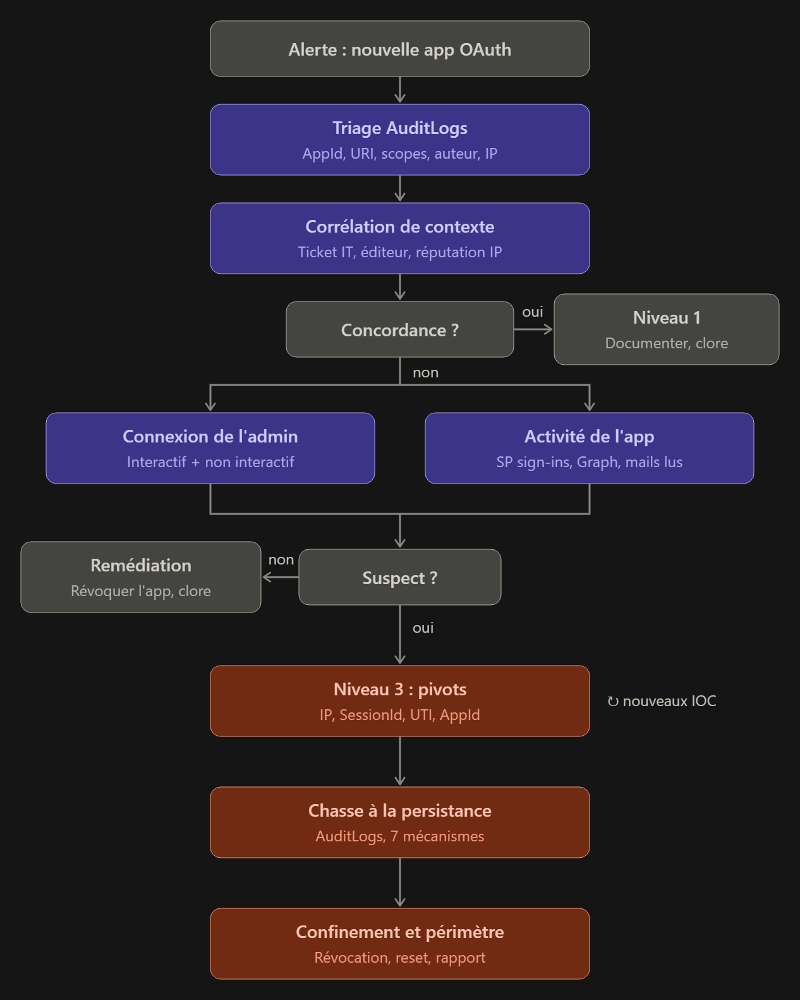

# Scenario of the Week 15 — Global Admin Registers an OAuth Application with Full Mailbox Read Access

**Published:** 2026-11-11

## 🎬 Scenario

```
An alert shows that a global admin account in your Microsoft 365 tenant registered a new OAuth application with
full mailbox read permissions. The registration happened at 10:30 AM on a Saturday. Your IT team recently approved
a third-party email archiving tool that required similar permissions, and the rollout was scheduled for this month.
```

## 🧭 Guided Questions

- What's your gut telling you and how would you confirm it?
- What questions would you ask?
- What would you investigate and in what order?
- Who would you communicate with and when?

## 📝 First Response

**What's your gut telling you and how would you confirm it?**

Before starting the investigation, I lack some notions about the OAuth protocol to properly understand the alert. I take some time to learn about it by asking myself two questions:

- **Why is OAuth an important notion in IT?** OAuth (Open Authorization) is a key standard in IT because it lets applications access a user's protected resources without ever exposing their credentials (username and password). This delegated authorization protocol relies on the exchange of temporary access tokens, which makes digital services interoperable and simplifies the user experience through single sign-on (SSO). In everyday life, OAuth is used whenever a website or application lets you sign in with a social network platform instead of classic credentials.
- **How does OAuth relate to cybersecurity and investigation?** OAuth improves security by removing the need to store sensitive passwords in third-party applications, which reduces the risk of data breaches and identity theft. OAuth is also a preferred attack vector: through consent phishing or token theft, an attacker obtains persistent access that bypasses MFA and password reset.

I then move to the qualification of the alert. I start by laying out the context / anomaly / priority triptych to define a scope and organize the data:

- **Context** — In Microsoft 365, at 10:30 AM on a Saturday, an admin account registered a new OAuth application with full mailbox read permissions. A third-party email archiving tool requiring similar permissions was approved, and its rollout was scheduled for this month.
- **Anomaly** — An admin account registered a new OAuth application with full mailbox read permissions at 10:30 AM on a Saturday. What is suspicious is the off-hours timing combined with a privileged account adding rights.
- **Priority** — Identify the application that registered the new OAuth app, to quickly rule out or confirm the approved email archiving tool lead.

I set hypotheses on two main axes to segment the analysis:

1. **False positive** — A legitimate action by IT, setting up the archiving process through the third-party email archiving tool planned this month.
2. **True positive** — A global administrator account was used maliciously or without authorization (T1078.004), following credential or session theft (T1566.002, T1557, T1539), social engineering (T1656) or a malicious insider, to register an OAuth application requesting read access to all mailboxes (T1671), in order to obtain persistent access to e-mails (T1114.002).

I assess the starting state of the alert through the threat and impact lens:

- **Is it malicious?**
  - State: probably legitimate.
  - Clues: the full mailbox read permissions match the recently approved third-party archiving tool that required similar permissions, the rollout was scheduled for this month, and 10:30 AM on a Saturday.
- **What is the impact?**
  - State: cannot be determined with the information provided by the alert as it stands.
  - Form: access to data at tenant scale through an application with full read access to mailboxes.

Given the state of maliciousness and impact, I set a first quick win action according to its discriminating power relative to its cost (time, money, skill). Since a rollout of an application with similar rights was announced this month, my priority is to find out whether this legitimate rollout is what triggered the alert. The quick win is therefore to identify the application linked to the OAuth registration and cross-check it with IT contextual data (ticketing, communication e-mails, internal channels, project owner…).

I then calibrate a response plan on 3 graded levels, with the conditions that trigger each one:

1. **Level 1** — The application is legitimate and the action was explicitly planned by a ticket, an organizational communication or other irrefutable evidence: I document the analysis and the conclusion in the ticket before closing it.
2. **Level 2** — The action is not explicitly confirmed. While waiting for the organization's feedback, I analyze the operations performed by the OAuth application since its registration and correlate the authentication events with the admin account's activity events to understand the overall behavior and what happened. If nothing suspicious is found but the app is not approved, I create the revocation request for validation, then document and close the ticket.
3. **Level 3** — If the admin account is compromised or the application is considered malicious (behavior, reputation or IT confirmation), I escalate the incident to the incident response manager to respond to the threat in a global and coordinated way. After validation with the organization, I disable the app and initiate session/token revocation and credential reset of the global admin account, in addition to removing the malicious application's rights, followed by a forensic analysis to determine precisely what the threat did and accessed, to calibrate the rest of the response.

Finally, I set the volatility and consequence axes to determine the collection approach and the conditions that trigger it:

- **Volatility** — The alert is identity/cloud related, so the volatile data is the cloud logs (sign-in, audit, activity, mail access). My first reflex is to check the available data before exporting it if needed.
- **Consequence** — The possibility for a threat to read all the mails of a tenant exposes the organization to a data leak (personal or strategic), with an aggravating factor if the admin account is compromised, with these risks:
  - **Persistence:** the application stays active after a password reset and a session revocation.
  - **Tenant control:** the attacker can create accounts, secrets, roles or forwarding rules.
  - **Integrity:** sending mails from the mailboxes if a permission allows it.

**What questions would you ask?**

What data do I have available? Which application was granted the rights? Is there a communication or a ticket linked to an intervention? What are the sign-in activities around the global admin account? Did the application connect? What was its activity? Which mails were accessed? What are the admin account's activities in the alert's time window? Are there signs of persistence?

**What would you investigate and in what order?**

My first reflex is to check the data available to me without prioritizing preservation/export, because I assume that in a cloud environment the default retention lets me favor the quick win over the volatility axis. I first collect the information needed to identify the app and confirm the rights that were granted.

In the alert, IT is expecting a third-party archiving tool. When a new OAuth application appears in a tenant, it generally generates:

- **Case 1:** for a third-party SaaS tool (the vendor's multi-tenant app), `Add service principal` (complemented by `Add app role assignment to service principal`).
- **Case 2:** for an app registered in the tenant, the `AddApplication` event (complemented by `Add app role assignment to service principal` and `consent to application`).

Case 1 is logically expected. Case 2 could indicate a specific request from the application's vendor, or that this is not the approved tool.

To understand what this implies, I take the time to detail the main source of these events, `AuditLogs`, with a list of useful fields oriented toward response efficiency:

| Information | `AuditLogs` field |
| --- | --- |
| **Name** | `TargetResources[].displayName` |
| **App ID** | `TargetResources[].modifiedProperties`: `AppId` |
| **Redirect URI** | `TargetResources[].modifiedProperties`: `AppAddress` |
| **Requested permissions** | `TargetResources[].modifiedProperties`: `RequiredResourceAccess` |
| **Granted permissions** | `Consent to application` and `Add app role assignment to service principal` events |
| **Author** | `InitiatedBy.user.userPrincipalName` |
| IP | `InitiatedBy.user.ipAddress` |
| Time | `ActivityDateTime` |
| Operation | `CorrelationID` |

- **App ID:** confirm the application with a more reliable identifier than its name, to compare with the one provided by the vendor or the IT team.
- **Redirect URI:** verify that the destination of the codes or tokens matches a trusted vendor.
- **Requested and granted permissions:** compare the request to the validated scope and check whether access was actually granted, to measure the impact.
- **CorrelationID:** groups the events of a single operation.

I use this information to compare it to what I can find in the organization's communication channels (ticket, e-mail, chat, portal). The idea is to highlight inconsistencies (unknown App ID, unvalidated vendor, suspicious redirect…) and to perform an IP reputation/context analysis through AbuseIPDB and IPinfo.io. If the information matches and the reputation/context is consistent, I apply level 1 defined in the qualification, namely documentation and ticket closure. If, on the contrary, the information does not match, I check the ongoing activity and push the analysis toward the admin's sign-in and the application's activity by pivoting on the IP, the time and the `AppID`.

With the IP and a time window before 10:30 AM, I analyze the interactive `SigninLogs` and the non-interactive `NonInteractiveUserSignInLogs`.

To understand what this implies, I take the time to detail the main source. During a sign-in, Entra ID does not just verify the password: it records context around the sign-in and creates technical identifiers used in other logs. The context lets me rule on the legitimacy of the admin account's sign-in, and the identifiers then let me find the actions performed during the session.

I start by analyzing the context with the following fields and associated checks:

| Information | Field | What I check |
| --- | --- | --- |
| **IP** | `IPAddress` | Same as the audit event's IP? Usual IP? |
| **Provider** | `AutonomousSystemNumber` | Hosting provider, VPN or Tor |
| **Location** | `LocationDetails` | Usual country, impossible travel |
| **Device** | `DeviceDetail` | Known, managed and compliant device |
| **Browser or tool** | `UserAgent`, `AppDisplayName` | Usual browser or unusual tool |
| **MFA** | `AuthenticationRequirement`, `AuthenticationDetails` | MFA performed with the usual method |
| **Conditional access** | `ConditionalAccessStatus` | Policies applied |
| **Risk** | `RiskLevelDuringSignIn` | Entra ID Protection signal |
| **Result** | `ResultType` | Failures before the success |

I then compare this information with the admin's habits over the last 30 days:

- Everything is consistent with the habits: the sign-in seems legitimate, but I confirm directly with the admin that the sign-in was legitimate.
- Unusual context with successful MFA: possible AiTM phishing, the attacker having relayed the authentication.
- Same `SessionId` from another IP or another device, without new MFA: possible session theft.
- No sign-in from the action's IP: possible token reuse.

In parallel, I determine whether the application connected by inspecting the data linked to the `AppID` in the sign-in table `AADServicePrincipalSignInLogs`. If I find something, I continue with `MicrosoftGraphActivityLogs` and `MailItemsAccessed`. To understand what this implies, I take the time to detail the main sources. These two sources describe the same access seen from two different sides:

- `MicrosoftGraphActivityLogs`: Microsoft Graph is the API through which applications access Microsoft 365 data. This log records every HTTP request received by Graph for your tenant, whether it concerns mails, files, users or the directory, showing what the attacker was trying to do.
- `MailItemsAccessed`: an Exchange Online mailbox audit event, surfaced in the Unified Audit Log. Exchange records it every time a mail is read or synchronized, whatever the path, showing what the attacker looked at.

From the moment the context is unusual, discovery behaviors appear or sensitive mails were accessed, I switch to level 3 of the response plan defined in the qualification and I identify the technical pivots to trace the admin account's activity and define the scope of the threat:

| Pivot | Source | What it lets me find |
| --- | --- | --- |
| **Suspicious IP** | `SigninLogs` (`IPAddress`), `AuditLogs` | Sign-ins of other accounts from this IP, other administration actions from this IP |
| **`SessionId`** | Interactive and non-interactive sign-ins, Unified Audit Log (`AADSessionId`) | All the session's activity, and the new IPs used, which I add to the pivots |
| **`UniqueTokenIdentifier`** | `MicrosoftGraphActivityLogs` (`SignInActivityId`), Unified Audit Log (`UniqueTokenId`) | The API calls made with this token, notably persistence created through Graph |
| **`AppId` of the new app** | `AADServicePrincipalSignInLogs`, `MicrosoftGraphActivityLogs`, UAL (`MailItemsAccessed`) | Whether the app has already been used and which mailboxes were read |

I then go back to the `AuditLogs` level to highlight different persistence mechanisms, using the technical pivots and the associated events:

| Persistence mechanism | `AuditLogs` events | What I check | Why it is persistence |
| --- | --- | --- | --- |
| **Secrets or certificates added** | `Update application – Certificates and secrets management`, `Add service principal credentials` | Secret added on the new app or on other existing apps, by the suspect account or from the identified IPs and sessions | The secret lets the attacker sign in as the application, without password or MFA. It survives the admin account reset |
| **Owners added** | `Add owner to application`, `Add owner to service principal` | Unknown new owner, or added outside the planned change, by the suspect account or from the identified IPs and sessions | An owner can add secrets later, even without being an admin |
| **Other consents or permissions** | `Consent to application`, `Add delegated permission grant`, `Add app role assignment to service principal` | Other apps that received permissions in the same window, especially mail, files or directory, by the suspect account or from the identified IPs and sessions | Multiplies the access points: deleting a single app is not enough |
| **New accounts or roles** | `Add user`, `Add member to role`, `Add eligible member to role` | Account created or privileged role (Global Admin, Application Admin…) assigned by the suspect account or from the identified IPs and sessions | Gives an admin access independent of the compromised account. `Add eligible member to role` covers PIM roles that can be activated later |
| **New MFA method** | `User registered security info` | Method added on the admin account (phone, authenticator app, FIDO key) shortly before or after the app creation by the suspect account or from the identified IPs and sessions | The attacker can pass MFA themselves, even after a password change |
| **Weakened conditional access** | `Add conditional access policy`, `Update conditional access policy`, `Delete conditional access policy` | Policy disabled, deleted, or exclusion added (user, IP, country) by the suspect account or from the identified IPs and sessions | Removes the controls that would block the attacker, such as mandatory MFA or country blocking |
| **Domain federation change** | `Set domain authentication`, `Set federation settings on domain` | Domain switched to federated, or signing certificate modified by the suspect account or from the identified IPs and sessions | The attacker can forge their own tokens for any user in the domain. This is the most serious persistence |

The investigation flow, illustrated:



- **Purple: analysis.** These are the steps where I collect and cross-check data without concluding.
- **Gray: decisions and outcomes.** This groups the starting point (the alert), the two branches ("Match?" and "Suspicious?") and the two exits without escalation (Level 1 and Remediation).
- **Coral: level 3 escalation.** This is the incident response.

Once the scope and the impact are fully delimited, I move to the eradication phase in a single coordinated window through the following steps:

1. Delete the secrets and certificates.
2. Disable or delete the affected applications.
3. Remove the consents.
4. Delete the added MFA methods.
5. Reset the account's credentials and revoke the sessions.
6. Roll back the role, conditional access and federation changes.

For the post-incident phase, I organize it into 5 axes to validate the ticket closure and anticipate a new attack:

- **Verify the eradication before closing the ticket:** launching the eradication actions does not guarantee that they all worked, nor that I forgot nothing. I therefore re-run the same hunting queries as during the investigation: secrets and certificates, application owners, consents, roles, MFA methods, conditional access policies and federation settings. If a persistence reappears, the incident is not over and I go back to eradication. This verification moves the incident from "handled" to "closed".
- **Preserve the evidence:** during triage, I chose not to prioritize log export in order to go fast. Once the incident is confirmed, the priority reverses: the default retention is short, and these traces may serve for legal follow-up, an insurance claim or a later analysis. I therefore export the `AuditLogs`, the sign-ins, the Graph logs and the `MailItemsAccessed` events linked to the incident, with the timeline I reconstructed. The collected evidence is kept with its chain of traceability, in accordance with the retention policy.
- **Block what was identified:** the attacker reaches the tenant through Entra ID from the Internet: their traffic does not go through the perimeter firewall, so I block where the access happens. I add the malicious IPs to a named location blocked by conditional access, and I declare the IPs and domains as threat indicators in Sentinel or Defender to be alerted if they reappear. I know that an attacker's IP changes quickly (residential proxies, disposable AiTM infrastructure): this blocking is useful but limited, and phishing domains or the `AppId` have more value.
- **Detect a possible recurrence:** I create analytic rules covering the incident scenario: consent to an app requesting mail or directory permissions, secret added to a service principal, global admin sign-in outside known locations, abnormal volume of `MailItemsAccessed` by an application. In parallel, I set up enhanced monitoring of the accounts and IOCs concerned for 30 days, because an attacker who loses access often tries to come back.
- **Capitalize on the alert through documentation:** I finalize the incident documentation with the timestamped timeline, the findings, the reasoning that guided the analysis and the conclusion, as well as the final classification.

On the improvement side, to strengthen the organization's defensive position following the alert:

- Initiate a blameless RETEX on the handling of the alert, on compliance with (or absence of) the procedure, and on MTTD and MTTR, to identify improvement areas and update the playbook.
- I recommend phishing-resistant MFA (FIDO2) for privileged accounts, since it neutralizes AiTM relaying. I add PIM so that no global admin is permanent, and a conditional access policy dedicated to administration roles that requires a compliant device and a known location.
- I review the change management process by requiring the vendor's `AppId` in any change ticket involving an OAuth application, so that a similar alert can be triaged immediately.
- I integrate the lessons of the incident into the playbook: the queries used, the pivots that were effective and the decision points, for training and optimization of the response for the next analyst.

**Who would you communicate with and when?**

*Taking charge.* I start by assigning the ticket to myself and moving it to "In progress". I then notify my team in the shared channel that I am taking the alert, so that any potentially related new ticket is forwarded to me. Depending on the team size and the severity, this communication also lets the work be distributed to speed up the response.

*Qualification.* If the application has not been formally validated, by a ticket or another channel, I contact the IT admin and the AppSec team to get more context. Since the admin account is potentially compromised, I do so through an out-of-band channel (phone, verified Teams) rather than by mail: the attacker may be reading their messages.

*Escalation when the threat is confirmed.* As soon as the threat is confirmed, I notify my manager and the incident response manager. Depending on the severity, they decide whether to open a crisis cell and coordinate the actions. I provide the summary of my analysis: timeline, identified scope, IOCs and recommended actions.

*Teams in charge of the response.* I ask the teams concerned to carry out the response actions, each on their own scope:

- The IAM / Entra ID administration team revokes the sessions, resets the credentials, removes the added MFA methods, disables the application, removes the consents and secrets, and restores the roles, conditional access and federation.
- The messaging team (Exchange Online) checks the forwarding and inbox rules and the delegations on the affected mailboxes, and helps measure the scope of the mails accessed.
- The workstation / EDR team isolates and analyzes the admin's device if token theft or an infostealer is suspected.
- The AppSec team and the application owner confirm the legitimacy of the archiving tool, and verify that the approved application was not itself hijacked.
- The CISO validates the high-impact decisions, such as cutting off a global admin's access or disabling a business application.

*Impact and obligations.* Depending on the measured impact, I communicate to the DPO the data concerned so that they can assess the obligation to notify the CNIL (72 hours) and to inform the individuals. I escalate to management the elements needed if legal action is considered: filing a complaint, an insurance claim, a report to a state agency. The legal and communication departments intervene if the incident must be communicated internally or externally.

## 🧠 Expert Review

*Technical details on Microsoft log names, prerequisites, licensing and retention below are marked "to verify": they come from general knowledge and must be checked against Microsoft's documentation or a real tenant.*

**1. Nothing limits the exposure while the plan waits for the organization.**
Level 2 waits for "the organization's feedback" on a Saturday, and level 3 disables the app only "after validation with the organization". If the permission is of the *application* family, the app can read mailboxes across the tenant without any user signed in (to verify), and it does so during the whole wait. Meanwhile, the plan has no criterion that triggers a containment action before IT answers. "If the application is considered malicious" is an a-posteriori criterion: it is met after the evidence, which is exactly what the wait delays. There is a middle path between waiting and deleting: disabling the service principal is reversible, keeps the object, its configuration and its logs, and costs little if the tool turns out to be legitimate (a one-day delay on a planned archiving rollout). It does not stop a token already issued until it expires, and it does not address a compromised admin account, who could re-enable the app or create another one (to verify). What observable facts, available in the first minutes, would make you disable it before IT replies, and who has the authority to do so on a Saturday?

**2. The log sources that carry your plan may not exist.**
The plan relies on `AADServicePrincipalSignInLogs`, `MicrosoftGraphActivityLogs` and `MailItemsAccessed` to learn what the app did and which mails were read, and on the "default retention" to justify putting the quick win before any export. Several of these sources depend on a diagnostic setting sending them to a workspace and are not retroactive, and `MailItemsAccessed` depends on an audit level tied to licensing (to verify). The step "I check the available data" is an intention, not an action: which query tells you which tables exist and since when (for example the minimum and maximum `TimeGenerated` per table)? If the first log line is later than the registration, the app's own activity during the gap is invisible, not just the context before it. In that case the impact statement must not become "no read observed"; it stays "reads possible for everything the permission allows". Absence of evidence is not evidence of absence.

**3. "Read access to all mailboxes" is not one thing.**
The plan states the impact as "cannot be determined" and writes the permission as "full mailbox read rights". There are two families (to verify): a *delegated* permission lets the app act on behalf of a signed-in user and limits it to what that user can access, while an *application* permission lets the app act under its own identity, up to every mailbox in the tenant unless restricted on the messaging side. The family bounds the worst case from the registration or consent event, in seconds. It also changes where the app's activity is visible: `AADServicePrincipalSignInLogs` shows apps that authenticate on their own, while a delegated app appears in the signed-in user's sign-ins, interactive for the consent and non-interactive for background token use. For an archiving job, which runs on a schedule without a user, which family is the most plausible, and what does that do to the impact?

**4. Case 1 / case 2, and the AppId that cannot be compared.**
You write that case 1 (a third-party SaaS tool, `Add service principal`) is "logically expected" and case 2 (`AddApplication`) would suggest a specific request or a different tool. The alert says the admin *registered* an application, which points to case 2: an app object created in your own tenant, with a secret or certificate that someone holds. Two different gestures hide behind "OAuth app": consenting to a vendor's multi-tenant app creates only a service principal, while registering creates an app that authenticates alone, without a user and therefore without MFA, which is the property an attacker looks for too. The gesture alone does not separate the two. In case 2 the `AppId` is generated at registration, so a ticket written before cannot contain it: comparing it "with the one provided by the vendor" is circular. What can be announced beforehand and found in the log is the vendor, the permission scope, the executor, the date and, if the vendor documents one, the redirect URI; what you compare is the announced scope against the permissions actually *granted*, not only requested. Which announced elements would you demand in the ticket before accepting the match?

**5. Level 1 can close on a ticket without hearing from the admin.**
Level 1 closes the alert on "a ticket, an organizational communication or other irrefutable evidence", yet the account that acted is a global admin who may be compromised. An attacker can name an app "Email Archiving" while a ticket really exists for the real tool, so a ticket does not prove that *this* registration, by *this* account at 10:30, is the one the ticket describes. Your own sign-in branch confirms the sign-in "directly with the admin", but level 1 does not. Closing should require the executor's confirmation through an out-of-band channel, in addition to the match.

**What was solid.** The context / anomaly / priority triptych, and two real hypotheses (legitimate rollout versus misuse of a privileged account) rather than defaulting to malicious, with the true-positive hypothesis tied to ATT&CK techniques. A summary diagram of the investigation flow that makes the order of the steps and the branching visible. A volatility reasoning adapted to a cloud-only environment (logs, not endpoint artifacts) rather than a transposed endpoint reflex. The quick win chosen by discriminating power over cost, and the instinct to start from the planned rollout instead of from the alarm. The decision to contact the admin through an out-of-band channel because the account may be compromised. The tables of `AuditLogs` fields, sign-in context and persistence mechanisms, built to understand rather than copy, with the pivots (`SessionId`, `UniqueTokenIdentifier`, `AppId`) made explicit. The seven persistence mechanisms, including the one that survives a password reset and the federation change. The post-incident reasoning that reverses the evidence-preservation priority once the incident is confirmed, the check that eradication actually worked, and the improvements that target the root cause (phishing-resistant MFA, PIM, the vendor's `AppId` in change tickets). The communication plan, which names who executes what and when the DPO and legal come in.

## 🪞 Reflection

1. **I referenced ATT&CK techniques when defining my hypotheses.**2. **I kept my focus on the quick win and on efficiency.** I framed my exchanges with Claude and stopped myself from going too wide. The idea was to concentrate on what is useful and to push my understanding of the sources by taking the time to go deeper into them.
3. **I reasoned about volatility in the sense that the tenant environment changes the approach.** However, my first reflex should really have been to verify the logging (see point 2 of the Expert Review: the sources the plan relies on may not exist).
4. **I added a global diagram of the investigation flow, as in the previous scenario.** I find it a habit worth keeping for future scenarios.
## 🔁 Revised Response

**What's your gut telling you and how would you confirm it?**

The triptych, the two hypotheses and the qualification method are unchanged. Four things change.

- **Impact bounded by the permission family.** I no longer start from an impact that "cannot be determined". The permission family is a fact I read in the registration or consent event: a *delegated* permission limits reading to the Global Admin's mailbox and the ones shared with them, while an *application* permission lets the app read up to every mailbox in the tenant, unless restricted on the messaging side. For an archiving tool (a scheduled job, no user), the application family is the most plausible. Until I have verified the scope, I assume the worst case.
- **Match criterion in case 2.** The alert says the admin *registered* an application, which points to case 2 (an app created in my own tenant, with a secret held internally), not to case 1, which I had judged expected. In that case the `AppId` is generated at registration, so a ticket written before cannot contain it. I therefore compare what was announced beforehand (vendor, permission scope, executor, date, redirect URI if documented) against the permissions actually *granted*.
- **Level 1.** I no longer close on a ticket alone: the confirmation of the admin who acted, through an out-of-band channel, is required from level 1, in addition to the match.
- **Disabling before IT replies.** I disable the service principal (reversible, the object and the logs are kept) without waiting for IT in these cases:
  - application family and the admin is reachable and denies the action;
  - application family, the admin is unreachable after 15 minutes and at least one anomaly is present (granted permissions different from what was announced, no matching ticket, unusual sign-in context);
  - the admin confirms but the facts do not match: I disable and verify out of band.

  If the admin is unreachable and there is no anomaly, I continue the investigation and escalate to the incident response manager after 60 minutes. The principle: a reversible, low-cost action justifies a low trigger threshold.

On volatility, my first reflex is to verify which logs exist and since when (see below), not to assume the default retention is enough.

**What questions would you ask?**

Unchanged, with the addition of: what is the permission family and its scope? Which activity tables exist, and since when?

**What would you investigate and in what order?**

- **First reflex: verify the available logs**, in parallel with the search for the ticket. I check the Entra ID diagnostic settings and I query the minimum and maximum `TimeGenerated` per table (`AuditLogs`, `AADServicePrincipalSignInLogs`, `MicrosoftGraphActivityLogs`); for `MailItemsAccessed`, I run an audit search over the period.
- **Impact rule when logs are missing.** If the first log line is later than the registration, there is a blind period on the app's own activity. The ticket then says "no read observed over the covered period", never "nothing was read": absence of evidence is not evidence of absence.
- **Pivot by family.** Application family: `AADServicePrincipalSignInLogs` filtered on the `AppId`, no user involved. Delegated family: `SigninLogs` and `NonInteractiveUserSignInLogs`, filtered on the `AppId` and the Global Admin's account.

The rest of the investigation (`AuditLogs`, sign-in context, `MicrosoftGraphActivityLogs`, `MailItemsAccessed`, pivots, the 7 persistence mechanisms, eradication, post-incident, improvement) is unchanged.

**Who would you communicate with and when?**

Unchanged on taking charge, qualification and obligations (DPO, legal). What changes: for disabling before IT replies, the on-call IAM team executes, then the incident response manager, with a 30-minute delay. As a last resort, I do it myself if my rights allow it, only when the disabling criterion is met. What I have not settled: who decides and who executes, how the delays add up (15 + 30 minutes), and the basis of the analyst's authorization (a playbook, or an assumed decision traced with an immediate report).
